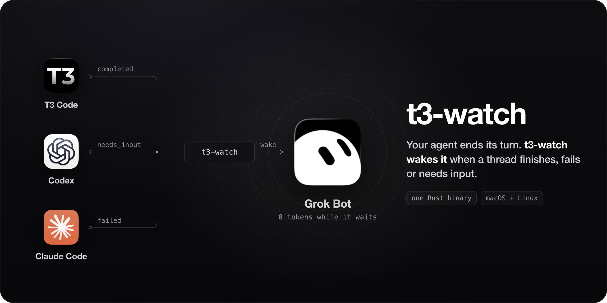

# t3-watch

t3-watch wakes your agent when a [T3 Code](https://t3.codes), [Codex](https://developers.openai.com/codex) or [Claude Code](https://claude.com/product/claude-code) thread finishes, fails or needs input. The agent spends no tokens while it waits.

It works with any agent that can run a background command or receive a webhook: Grok Bot, Claude Code, Codex, Cursor or a shell script.

## "Wait, why not just poll?"

An agent that starts a long thread usually calls `t3_thread_read` over and over, or keeps a subagent open until the thread finishes. Both burn context and tokens.

With t3-watch, the agent starts `t3-watch wait` as a background command and ends its turn. When the thread settles, t3-watch prints one line of JSON and exits with a code that says what happened, and the agent wakes up once.

- One small Rust binary with TLS built in. No Python or Node runtime.
- Twenty agents watching the same thread share one background daemon and one upstream long-poll.
- A question or approval wakes the agent with its own exit code, even while the run still says `running`.
- Cloudflare tunnel errors and a sleeping laptop don't cause false wakes. A revoked token fails fast with exit 2.
- A bot with no background terminal can get a signed webhook instead. With `--durable`, an undelivered webhook stays on disk and is retried until the receiver accepts it.

## Installation

> [!WARNING]
> t3-watch runs on macOS and Linux. Windows is not supported.
>
> - T3 Code threads: T3 Code on this machine, or a T3 Connect relay for another machine.
> - Codex threads (experimental): a Codex app-server on its control socket. The desktop app hasn't been checked yet.
> - Claude Code sessions (experimental): the t3-watch hook added to your Claude Code settings.

There is no tagged release yet, so build from source with Rust 1.85 or newer:

```bash
git clone https://github.com/krishhgg/t3-watch.git
cd t3-watch
cargo install --path . --locked
```

Once a version is tagged, CI attaches builds for macOS (arm64, x86_64) and Linux (x86_64, arm64) to the GitHub release.

### Teach your agent to use it

Copy [`skills/t3-code-watch`](./skills/t3-code-watch/SKILL.md) into your agent's skills folder, for example `~/.claude/skills/` for Claude Code. The skill tells the agent when to start a watcher, what each exit code means, and how to run it from Claude Code, Codex, Cursor, Grok Bot or a shell hook.

## Quick start

```bash
# A thread on this machine. No setup.
t3-watch wait mcp:launch:abc123

# The turn after a follow-up message, so the previous result can't wake you
t3-watch wait mcp:launch:abc123 --expect-min-run-ordinal 2

# A thread on another machine. Sign in once, then wait on it.
t3-watch auth login https://<your-relay>.t3coderelay.com --name mini
t3-watch wait --machine mini mcp:launch:abc123

# Native sessions (experimental)
t3-watch wait codex://threads/<thread-id>
t3-watch wait claude-code:<session-id>
```

The exit code says what happened:

| Exit | Meaning |
| --- | --- |
| 0 | Completed |
| 5 | Needs input (a question or an approval is waiting) |
| 6 | Failed, interrupted or cancelled |
| 3 | Timed out |
| 4 | Completed, but a webhook or hook could not be delivered |
| 2 | Error, such as a rejected token, an unknown thread or a bad argument |

## Some notes

This project is very early. Expect bugs.

t3-watch only watches. It reads thread state and pending questions, and it never answers a question, approves a request or sends a message.

The Codex and Claude Code adapters haven't passed their acceptance checks yet. [Limitations](./docs/limitations.md) lists what else is missing.

## Documentation

- [Usage, options and exit codes](./docs/usage.md)
- [Completion contracts (one turn or a whole workstream)](./docs/completion-contracts.md)
- [When a thread needs input](./docs/needs-input.md)
- [Webhooks, durable delivery and heartbeats](./docs/notifications.md)
- [Native Codex and Claude Code sessions](./docs/native-sessions.md)
- [How it works](./docs/how-it-works.md)
- [Security](./docs/security.md)
- [Benchmarks](./docs/benchmarks.md)
- [Limitations](./docs/limitations.md)

Building from source or running the tests? Start at [docs/development.md](./docs/development.md).

## License

MIT or Apache 2.0, at your option. See [LICENSE-MIT](./LICENSE-MIT) and [LICENSE-APACHE](./LICENSE-APACHE).
